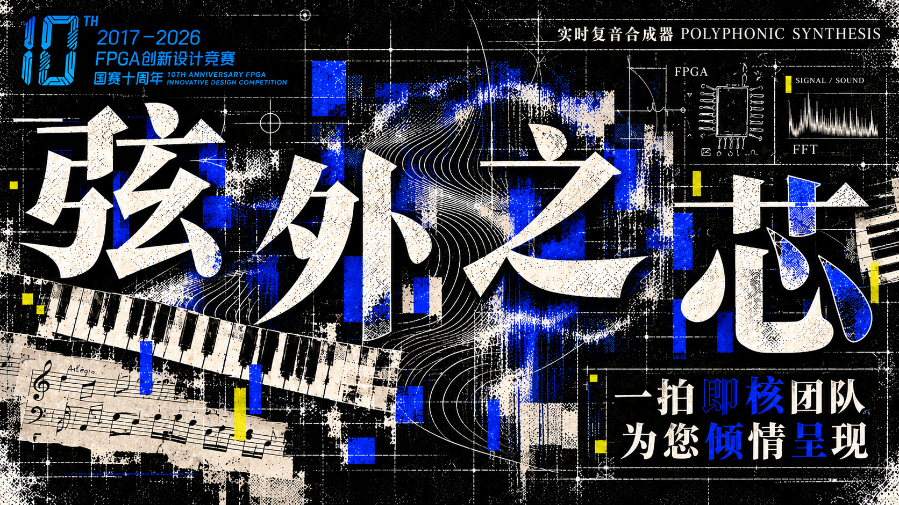
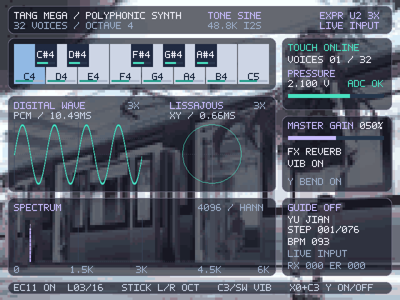
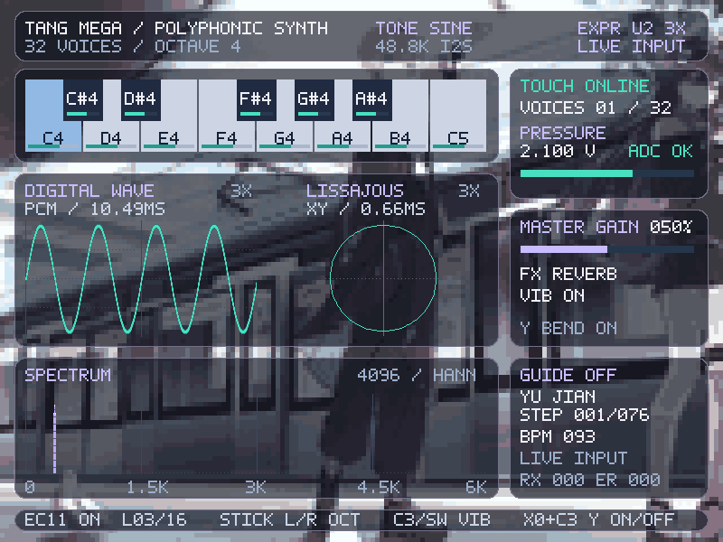
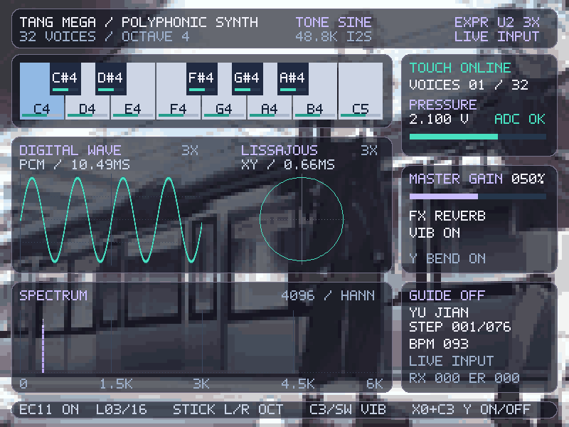
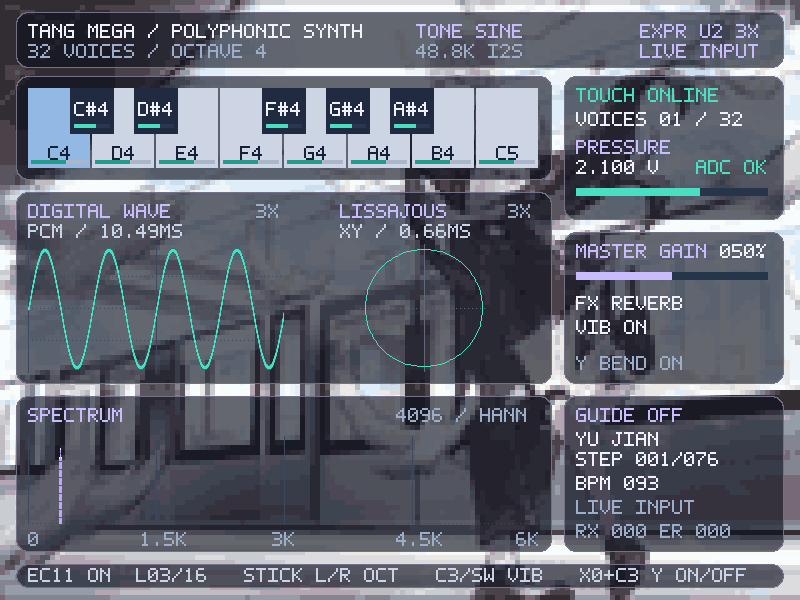
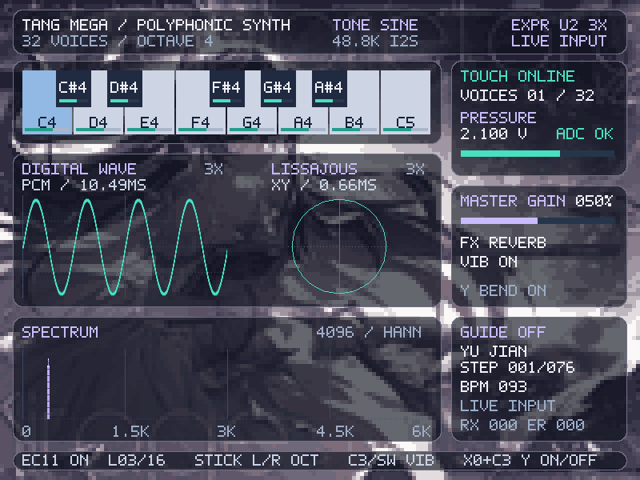
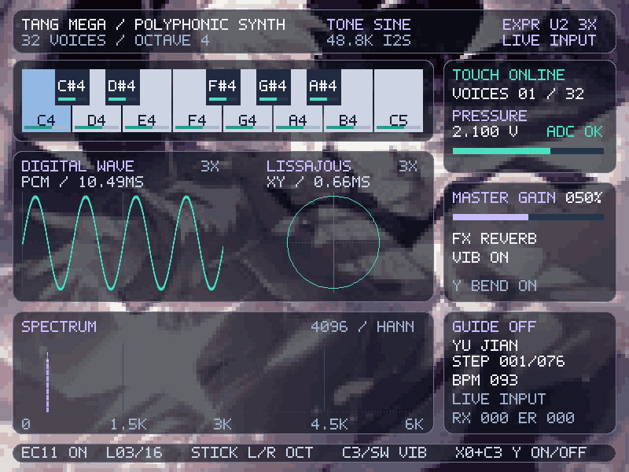
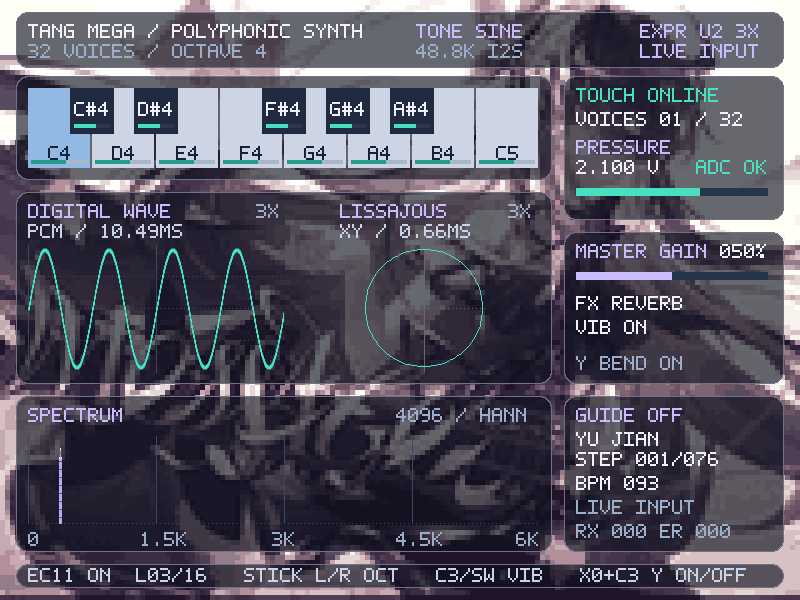
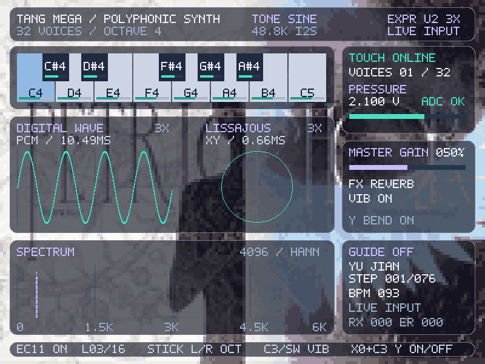

# 弦外之芯——实时复音合成器



**一拍即核团队 | 2026 FPGA 创新设计竞赛 | 高云赛道赛题二**

以 Tang Mega 60K NEO 为核心的电子乐器。FPGA 通过 HDL 完成逐样本合成、包络、混音与 I²S 输出；触摸琴键、压力片、摇杆和旋钮连接演奏动作，HDMI 与琴键灯同步呈现声音和曲谱指引。

## 核心数据

| 项目 | 实现与验证结果 |
|---|---|
| 复音引擎 | 32 个独立相位、频率与包络状态；RTL 最重帧 829 / 1024 时钟 |
| 音键与音色 | 13 个触摸音键，4 档音区、49 个不同音高；4 种数学波表音色 |
| 数字音频 | 16 bit I²S；50 MHz / 1024 = 48,828.125 Hz 标称采样率 |
| 演奏控制 | 压力调节整体音量，摇杆切换音区与颤音，EC11 控制延音及 16 档衰减 |
| 可视化 | 800 × 600 HDMI；512 点波形、4096 点 Hann FFT、延迟李萨如轨迹 |
| 脱机指引 | 内置 76 音《遇见》片段，按对推进；UART 曲谱容量 512 步 |
| 实现资源 | Logic 32,489 / 59,904；BSRAM 99 / 118；DSP 34.5 / 118 |

数据分别来自 RTL、仿真与 Gowin 布局布线报告。32 声部表示数字引擎容量；详细测试条件、数字通路延迟与时序数据见[发布验证记录](docs/release_verification.md)。

## 构建与使用

活动工程：[`instrument/instrument_expression.gprj`](instrument/instrument_expression.gprj)，器件 `GW5AT-LV60PG484AC1/I0`，顶层 `instrument_top`。

```powershell
# Gowin 1.9.12.03；路径按本机安装位置填写
./instrument/build.ps1 -GowinShell '<Gowin IDE>/bin/gw_sh.exe'

# XSim 回归（Vivado 2025.1 & Gowin GW5A 原语库）
./instrument/sim/run.ps1 -VivadoBin '<Vivado>/bin' -GowinSimLib '<Gowin IDE>/simlib/gw5a/prim_sim.v' -NoAnalysis -Only 'tb_display_gain,tb_expression_allocator,tb_expression_core,tb_expression_latency,tb_expression_top'

# 导出曲谱串口命令，无需连接设备
python instrument/tools/serial_control.py --score assets/scores/yujian.txt --bpm 93 --emit
```

构建产物为 `dist/instrument_expression_ui_v2_3x.fs` 与对应 manifest。构建脚本核对源码哈希、产物时间及 setup/hold/最小脉宽报告。下载选择 **GW5AT-60B → SRAM Program**。位流、视频和本机仿真中间文件不纳入 Git。

[工程打开说明](instrument/OPEN_IN_GOWIN.md) & [演奏与曲谱操作](docs/usage.md) & [引脚与接线](docs/wiring_current.md)

## 八套壁纸界面

以下为 **800 × 600 RTL 仿真截图**。壁纸以 160 × 120、16 色索引 ROM 存储，整数放大并轮播；波形与李萨如采用 3X 显示增益，音频及 FFT 输入保持原始 PCM。

| 01 | 02 |
|---|---|
|  |  |
| 03 | 04 |
|  |  |
| 05 | 06 |
|  |  |
| 07 | 08 |
|  |  |

壁纸素材取材于非传统下落式音游 **Phigros**，相关美术版权归原权利人所有。

## 仓库结构

| 目录 | 内容 |
|---|---|
| `instrument/src` | 合成、传感、I²S、HDMI 与可视化 RTL |
| `instrument/sim` | 模块、核心、顶层与接口回归 |
| `instrument/tools` | 曲谱、波表/壁纸生成、测量与发布核查工具 |
| `assets` | 波表、曲谱、壁纸及展示图片 |
| `docs` | 操作、接线、实现说明与历史验证记录 |

历史研发记录保留各自版本与测试条件。团队协作及贡献见[协作说明](docs/collaboration_update.md)。
