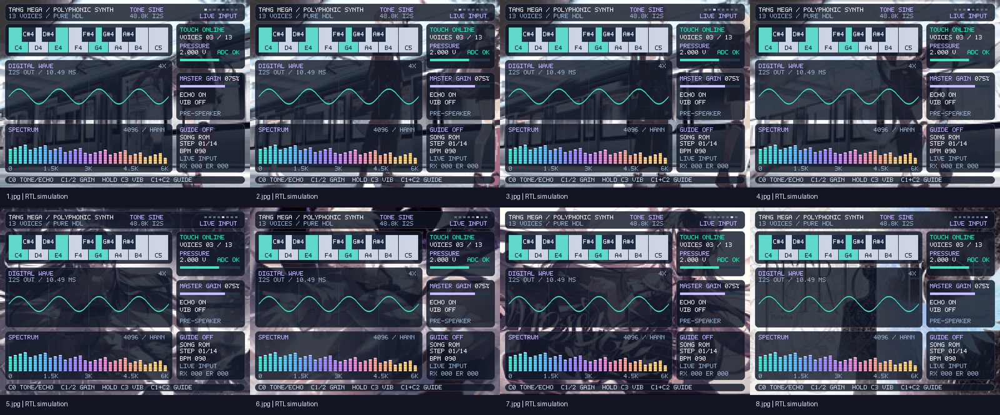

# FPGA 实时多音色电子乐器

Tang Mega 60K NEO（GW5AT-60B）上的纯 Verilog 电子琴，无处理器、MCU 或预录音频。

13 声部覆盖 C4～C5 半音阶，支持四音色、ADSR、音量、颤音、延迟效果、公共压力控制、八键灯、蓝牙参数控制与最多 64 步和弦跟弹。HDMI 输出 800×600，常驻琴键、实时 PCM 波形、4096 点 Hann 窗 FFT 和演奏状态。

HDMI 以 `assets/wallpapers/1.jpg`～`8.jpg` 为全屏壁纸，约每 10 秒轮换。图片居中裁剪为 4:3，以 192×144、每图 64 色存入片上 ROM；不需要 SD 卡或外接存储。更换图片后运行 `python instrument/tools/generate_wallpapers.py`，再构建、下载。轮播间隔由 `instrument_screen.v` 的 `WALLPAPER_HOLD_FRAMES` 设置（默认 600 帧）。



[轮播动图](assets/simulation/wallpaper_slideshow.gif) · [八声部频谱](assets/simulation/eight_voices_spectrum.png)。这些图片来自 RTL 仿真，不是实板照片；目录同时保留历史调试图。

`DIGITAL WAVE / 4X` 显示送往 I²S 的数字 PCM，固定 4 倍纵向放大（约 ±8192 PCM，超出范围截顶），不是麦克风测得的声压。主音量和压力会影响波形；音箱自身的滑片位于 DAC 之后，不反馈到屏幕。`MASTER GAIN` 表示压力调制前的数字主增益，百分比向下取整。

## 目录与构建

```text
assets/
  wallpapers/           八张壁纸原图（纳入 Git）
  simulation/           仿真图片、动图与历史图（纳入 Git）
instrument/
  src/                  Verilog、引脚与时序约束
  sim/                  RTL 回归与串口工具测试
  tools/                工具链定位、查表生成、音频/频谱分析、曲谱发送
  config/               Gowin 构建配置
  instrument.gprj       Gowin 工程
  build.ps1 / build.tcl 命令行构建入口
dist/instrument.fs      唯一下载位流（本地生成，不提交 Git）
hardware/               接线图（仅本地保留，不提交 Git）
.local/                 试听 WAV 等本地资料（不提交 Git）
```

使用 Gowin V1.9.12.03，在仓库根目录执行，路径按自己的安装位置填写：

```powershell
$env:GOWIN_HOME = Read-Host 'Gowin IDE 目录（内含 bin）'
powershell -NoProfile -ExecutionPolicy Bypass -File .\instrument\build.ps1
```

构建检查新位流、setup/hold、recovery/removal 和最小脉宽；全部通过后才更新 `dist/instrument.fs` 并输出 SHA256。中间文件在 `instrument/impl/`，不纳入 Git。可用 `-GowinShell` 指定 `gw_sh.exe`，或用 `-CheckTools` 只检查工具路径。

构建和测试结束后，运行 `powershell -NoProfile -ExecutionPolicy Bypass -File .\instrument\tools\clean.ps1` 清理缓存。脚本先保存仿真图片（PPM 无损转 PNG，重复像素去重）和 WAV，再删除中间文件；保留源码、`assets/`、`.local/` 和 `dist/instrument.fs`。加 `-WhatIf` 只预览。工程路径均相对仓库，外部工具位置通过参数、环境变量或 PATH 指定。

Gowin Programmer 选择 **GW5AT-60B → SRAM Program → dist/instrument.fs**，断电后需重新下载。摄像头功能已移除；断电后拔除摄像头供电与信号线，J13-23～37 不再使用，其余接线保持。

## 接线与控制

所有模块共地。J13 是底板物理针号，FPGA 球号以 `instrument/src/instrument.cst` 为准。

| 模块信号 | J13 针号 | FPGA 球号 |
|---|---|---|
| MPR121 A：SCL / SDA | 1 / 2 | E14 / E13 |
| PCM5102：BCK / LRCK / DIN | 3 / 4 / 5 | C15 / C14 / B13 |
| MPR121 B：SCL / SDA | 13 / 14 | A16 / A15 |
| ADS1115：SCL / SDA | 15 / 16 | A20 / B20 |
| 74HC595：SER / SRCLK / RCLK / OE | 17 / 18 / 19 / 20 | A21 / B21 / B18 / B17 |
| BT05：TXD → FPGA RX / RXD ← FPGA TX | 21 / 22 | C17 / D17 |

- **MPR121**：两块各用独立 I²C，总线不互连；3.3V 供电，ADD 均保留接地（0x5A），IRQ 留空，使用板载上拉。任一触摸板离线会释放音符并重试。
- **PCM5102**：现有底板 5V 供电，SCK 接地、FMT 经 1kΩ 下拉到该模块 GND、XSMT 高，模拟输出接有源音箱。FPGA 输出标准 I²S，对应 FMT 低电平；FMT 高电平会选择左对齐。其他模块须核实板载电阻／焊盘配置，不要混淆 FMT 与 XSMT。
- **ADS1115 + FSR402B**：3.3V 供电，ADDR 接地（0x48）；`3.3V → FSR → A0 → 10kΩ → GND`，0.1µF 跨接 A0/GND。A1～A3、ALRT 留空。量程 ±4.096V，本电路输入仍限于 0～3.3V。
- **74HC595**：16/VCC、10/SRCLR 接 3.3V，8/GND 接地；14/SER、11/SRCLK、12/RCLK、13/OE 按表接线；OE 另用 10kΩ 上拉，VCC/GND 旁接 0.1µF。QA～QH 各经独立限流电阻接 K0～K7 的 LED 正极，负极接地；保留已验证的电阻与接线，9/QH′ 留空。
- **BT05**：现有 ZS-040 底板 VCC 接 5V、GND 共地；TXD/RXD 是 3.3V 信号，EN/STATE 留空。仅适用于现有标明 Power 3.6–6V / LEVEL 3.3V 的底板。

| 触摸板 | 电极从 0 开始依次连接 |
|---|---|
| A：0～9 | K0、S0、K1、S1、K2、K3、S2、K4、S3、K5 |
| B：0～7 | S4、K6、K7、X0、C0、C1、C2、C3 |

其余电极留空。K0～K7 对应 C4/D4/E4/F4/G4/A4/B4/C5；S0～S4 对应 C♯4/D♯4/F♯4/G♯4/A♯4。S0 是 K0/K1 之间的第一块短铜箔。

C0 短按切换音色、长按切换延迟；C1/C2 调音量，同时长按切换跟弹；按住 C3 开启颤音，松开关闭；四个控制键同时长按切换八自然音正弦测试。X0 仅用于八灯全亮检查。

每键有独立振荡器与包络；音色在起音时锁定，切换后松开再按生效。四档为正弦、电钢琴感（快起音、指数衰减）、合成弦乐（约 42ms 起音、约 171ms 释音）、金属音，均由数学波表合成。波表使用 8 位小数插值，余音中同音色重按保持相位连续；混音固定增益，不因新增琴键而压低已有声部。八灯也是独立静态输出；若 HDMI 琴键保持而实灯熄灭，先用 `D1` 查看 X0 是否被识别，再检查 74HC595 与各 LED 的供电、限流和回地接线。

单片压力传感器控制公共音量：0V 为主音量的 25%，3.072V 及以上为 100%；ADC 离线时恢复主音量。默认主音量 50%，所以压力为 0V 时，幅度是同一音符在主音量与压力增益均为最大时的 12.5%；声音偏小时先用 V4096 配合重压核查。只按压力片不发声，这不是逐键力度检测。

## 蓝牙串口与曲谱

手机 Serial Bluetooth Terminal 使用已验证的 BT05 连接，文本/ASCII，每条末尾 LF 或 CRLF。FPGA UART 为 **9600 / 8N1 / 无流控**。每条等 `K` 成功回包再发下一条，`E` 表示拒绝。

| 命令 | 功能 |
|---|---|
| `?` | 通信检查，RX 加 1 |
| `T0`～`T3` | 正弦/电钢琴感/合成弦乐/金属音色 |
| `V0`～`V4096` | 主音量（压力继续参与调节） |
| `E0` / `E1` | 关闭/开启延迟 |
| `G0` / `G1` | 关闭/开启跟弹，重新开启从头开始 |
| `B40`～`B240` | 提示节拍 BPM |
| `R` | 恢复内置 14 步《小星星》 |
| `N`、`Axxxx`、`Z` | 开始上传、追加音符掩码、提交 |
| `D1` / `D0` | 显示/隐藏 UART 调试信息，默认隐藏 |
| `L0`～`L255` / `L256` | 十进制八灯掩码，保持 5 秒后自动恢复；L256 立即恢复琴键灯 |

灯故障排查可依次发送 `L8`（F4）、`L16`（G4）、`L24`（F4+G4）、`L25`（加 C4）、`L255`（全亮），每次观察后再发下一条。屏幕显示 `LED TEST`，不产生音符，触摸板离线时也可测试；命令回 K 仅证明数字命令被接受，不能证明灯已实际点亮。

`Axxxx` 为四位十六进制掩码：bit0～7 是 K0～K7，bit8～12 是 S0～S4。1～64 步，不能有空音符；按齐目标且无多余音符才前进，重复音需要松手再按。BPM 控制提示闪烁，曲谱不自动发声。上传失败需从 N 重来，Z 成功后才切换；断电恢复内置曲目。

```powershell
python .\instrument\tools\serial_control.py --song chords --bpm 90 --emit
# 有实际 SPP 或 USB-UART 数据串口时（不是 JTAG 下载口）：
python -m pip install pyserial
python .\instrument\tools\serial_control.py --port COM7 --song scale --bpm 100
```

将 COM7 替换为数据串口；BLE 不一定提供 COM 口。RX/ERR 是命令计数，不是蓝牙在线指示，均在 255 饱和。完整的 `TX=` 状态行静默处理。半行 1 秒超时后，先发 `!` 加换行，再发 `?` 对齐。旧页面命令 `P0/P1` 已删除，会回 E。

## 回归与上板检查

```powershell
python -m pip install -r .\instrument\tools\requirements.txt
$env:VIVADO_BIN = Read-Host 'Vivado bin 目录'
$env:GOWIN_HOME = Read-Host 'Gowin IDE 目录'
powershell -NoProfile -ExecutionPolicy Bypass -File .\instrument\sim\run.ps1
```

回归包含 26 项 RTL 仿真、独立音频/和弦/FFT 数值比较、八张壁纸的逐像素比较和 7 项串口工具测试。原始数据暂存 `instrument/sim/output/`；成功后图片保存到 `assets/simulation/`，WAV 保存到 `.local/simulation_audio/`。图片更新时，旧版本按内容哈希保存在 `history/` 子目录，不因清理而丢失。日志、原始数据、WAV 和缓存不纳入 Git。

`chords_after_four_tones.wav` 按正弦/电钢琴感/合成弦乐/金属顺序播放 C/F/G/Am 和弦，统一放大 4 倍用于试听；不是实板录音，也未与音箱校准响度。

下载后检查：`TOUCH ONLINE`、`ADC OK`（D1 调试页可查 A1/B1）；触键能发声且波形/频谱变化；按压力片能调节声音；X0 八灯全亮；手机发送 `?` 只回 K。屏幕不再显示 CAM/DVP 或摄像头预览。当前精简版须按此在实板复验，软件回归不能代替上板验证。
