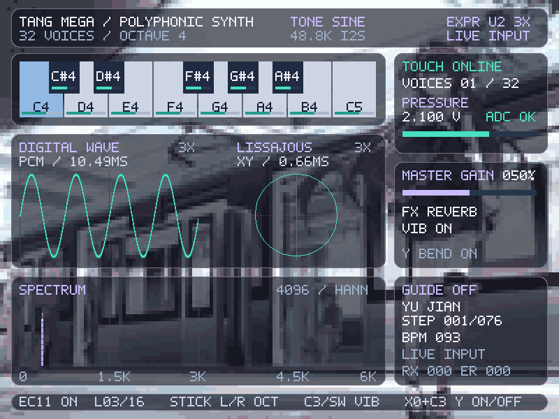

# 波形与李萨如固定 3X 显示缩放

针对实板反馈“图形只有约三分之一”，波形纵轴和李萨如 X/Y 双轴统一放大 3 倍。不是提高扬声器音量，也不使用会改变显示比例的自动增益。

- 当前下载文件：`dist/instrument_expression_ui_v2_3x.fs`。
- 右上角标识：`EXPR U2 3X`，两个图的标题行都显示 `3X`。
- 缩放位于 PCM 监测分支，送入波形和 XY 坐标量化之前；DAC 与 FFT 继续接原始 PCM。
- 计算为 `clip(3 × PCM, -32768, 32767)`，用 18 位有符号移位加法避免中间溢出。约 ±10923 的原始 PCM 已达到绘图区边界，超过时只在显示边缘截断，不回绕到另一边。
- 时间窗、触发、32 点延迟、音量、音效和 C15 接线均沿用 U2。
- 旧 1X U2 位流仍保留，修改前源码、manifest 和构建报告备份于 `backups/ui-v2-before-3x-20261101/`。

本轮验证覆盖全部 65536 个 PCM 输入的精确倍率、符号、单调性、上下界、1X 旁路及中心点；波形采样、XY 连线/双缓冲、完整屏幕和顶层连接。顶层测试明确检查缩放只进入波形与 XY，不能进入 FFT 或 DAC。

RTL 仿真截图（输入峰值 10000，经 3X 缩放后约占满绘图区；不是实板照片）：



复现本轮验证：

```powershell
.\instrument\sim\run.ps1 -Only 'tb_display_gain,tb_waveform,tb_lissajous,tb_expression_screen,tb_expression_top' -NoAnalysis
.\instrument\build.ps1 -Expression
python .\instrument\tools\audit_ui_release.py
```

测试日志、8 张壁纸下的 RTL 截图和发布审计位于 `outputs/ui-3x-20261101/`。本轮没有进行实板下载验收。

## 构建结果

2026-11-01 使用 Gowin V1.9.12.03 完成综合、布局布线与位流生成，发布前核对全部输入文件哈希及 38 个实际引脚的电气属性。原 L1 和 U2 1X 位流的哈希均保持不变。

| 资源 | U2 1X | U2 3X | 器件容量 |
| --- | ---: | ---: | ---: |
| Logic | 32551 | 32489 | 59904 |
| Register | 8432 | 8432 | 60780 |
| BSRAM | 99 | 99 | 118 |
| DSP | 34.5 | 34.5 | 118 |

新增 `visual_zoom` 单独占 15 ALU、6 LUT，无寄存器、BSRAM 或 DSP；整机 Logic 的小幅降低来自本次综合/布局映射，不能理解为放大模块具有负资源开销。

- 5 项相关仿真全部通过；65536 个输入已逐一核验。
- setup/hold 违例均为 0；最小 setup **0.003 ns**、hold **0.046 ns**、recovery **0.310 ns**、removal **0.589 ns**、脉宽裕量 **5.594 ns**。
- setup 裕量仍很窄，最紧路径为既有的 `core/controls/spectrum_mode` → `core/guide/position`，不是新增显示增益路径。保留 ref_clk 的通用布线警告；上述结果是工具静态时序检查，不代替实板验收。
- 默认布局算法的第一轮结果出现 HDMI serializer recovery **−0.110 ns**，未发布。仅将 `Place_Option` 由 0 改为 1 后重建通过，未修改时钟约束、视频复位 RTL 或检查标准。该选项含义见 [Gowin Tcl 命令手册](https://cdn.gowinsemi.com.cn/SUG1220.pdf)。第一轮报告保存在 `outputs/ui-3x-20261101/attempt-1/`。
- 最终报告：`outputs/expression-ui-v2-3x/`；源文件哈希：`dist/instrument_expression_ui_v2_3x.manifest.json`；交叉检查：`outputs/ui-3x-20261101/release-audit.json`。

位流大小 **20,778,835 字节**，SHA256：

```text
b7b51c410cd07ada8af9f80e706ba454c3c8c8d737faf5f1c6b5b62ae5f1221a
```
