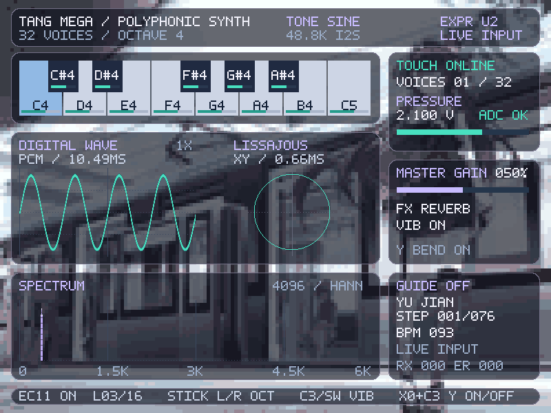

# EXPR U2：壁纸、李萨如与工作区清理（2026-11-01）

> 后续已按实板反馈增加波形/李萨如固定 3X 显示缩放，当前文件为 `dist/instrument_expression_ui_v2_3x.fs`，见 [3X 修订记录](display_zoom_3x.md)。以下保留初版 1X 的构建证据。
初版 1X 下载文件：`dist/instrument_expression_ui_v2.fs`，屏幕右上角 **EXPR U2**。原 `dist/instrument_expression_link_v1.fs` 保持不变。U2 已通过 RTL 仿真和布局布线，尚未下载到实板；这不表示此前外部音响无声问题已经解决。

## 保留与清理

- 唯一活动工程：`instrument/instrument_expression.gprj`。`build.ps1` 默认及 `-Expression` 均构建它，新位流使用独立文件名。
- 原 L1 位流 SHA256：`da65392c1d213eaf79da60ab2113a0c43fea8d154eaf34e2b5cb334276a129a4`。
- 清理前的未提交源码、工程、配置、工具、测试、文档、原始素材和 L1 位流位于 `backups/expression-link-v1-20261101/source/`。`source-manifest.json` 记录备份哈希，原始 Git 差异也单独保存。
- 7 个其他位流移入 `legacy-dist/`；24 个非当前工程/配置及 IDE 状态文件移入 `legacy-projects/`；旧 `impl` 移入 `previous-impl/`；35 个旧仿真产物移入 `old-simulation-products/`。均为可恢复归档，不清除用户的 `.local` 实测资料、硬件文件与历史文档。
- 已有 RTL 中本轮只修改 `instrument_top.v` 和 `instrument_screen.v`。全部音频、效果、触摸、压力、摇杆、GUIDE 源码及 `.cst/.sdc` 与清理前快照逐文件哈希一致。最终 P&R 的全部 38 个端口位置及电气属性也逐项与原 L1 报告一致。BCK 仍为 **C15/J13-3**，不是 D16。
- 归档提供清理时的可构建实现链路与原始 L1 位流；不声称换工具或重新布局后可得到逐字节相同的 L1 位流。

## 显示实现与边界

- 800×600 HDMI；原生 5×7 点阵字体、圆角半透明卡片、浅紫标题/频谱、青绿色波形/轨迹。依照用户参考图保留壁纸与玻璃面板风格。透明效果使用移位加法混色，不使用实时模糊或全屏帧缓冲。
- 恢复 `assets/wallpapers/1.jpg`～`8.jpg`，约每 10 秒在场消隐切换一次。160×120、每图 16 色、5 倍整数放大；不把低分辨率索引色背景说成原图高清画质。原 JPG 未修改，可重新生成 ROM。
- 壁纸有 38 个图像 ROM 加 1 个 32 位调色板 ROM 的逻辑实例；后者在本器件映射为 2 块物理 BSRAM，因此壁纸实际占 **40 块 BSRAM**，不是按实例数计算的 39 块。原旧壁纸方案为 72+1 个 ROM 实例，本版减少图像存储预算。
- 李萨如图：X 为实际送 I²S 的 PCM，Y 为延迟 32 个采样的 PCM，延迟 `32 / 48828.125 = 0.65536 ms`。当前左右输出同值，直接 L/R 只能画直线，因此明确显示 `XY / 0.66MS`。这是延迟相图，不是独立双声道相位测量，也不是预制动画。
- 128×128 一位轨迹，两个缓冲区，共 **2 块 BSRAM**；连接相邻点并只在场消隐交换所有权。每段最多 128 个系统时钟，音频间隔为 1024 个时钟；显示不对音频施加反压。完整采样 512 点，静音最终回到中心单点。波形与 XY 快照独立发布，不声称二者为完全同一批采样。
- DIGITAL WAVE 保留 512 点 / 10.49 ms 采样窗，在 256 像素内显示偶数采样点，纵向仍为 1X 满幅。4096 点 Hann FFT、全部 13 键反馈、GUIDE、UART 诊断和触摸离线故障自动显示保留。

## 为什么 LIMIT 经常出现

`audio_output.v` 的正常音频先把混音放大 8 倍；软拐点为 24576，即 16 位满幅的 75%。内部 `limited` 判定等价于混音 `abs(sum) > 3072`，而单音峰值可接近 4095。主音量和压力在此后才乘入，因此降低音量仍可能看到提示；多声部和音效叠加也会增加触发机会。

复现实验输入为峰值 4095 的单音正弦，每档统计 512 个采样：

| 主增益 | 触发软限幅的采样 | PCM 峰值 | 硬削波 |
|---|---:|---:|---:|
| 25% | 234 / 512（45.70%） | 7679 | 0 |
| 50% | 234 / 512（45.70%） | 15357 | 0 |
| 100% | 234 / 512（45.70%） | 30714 | 0 |

这是该输入下的 RTL 复现，不是实板演奏频率统计。现已移除主界面 `LIMIT` 字样；软限幅、饱和保护、内部 `limited/clipped` 诊断位以及音量/压力顺序保持不变。移除提示不会改变声音；软限幅本身仍会压缩并改变较大峰值。

## 最终构建

工具为本机 Gowin **V1.9.12.03**，时钟约束仍为系统 50 MHz、像素 40 MHz、串行 200 MHz。

| 资源 | 原 L1 | U2 | 器件总量 |
|---|---:|---:|---:|
| Logic | 31544 | 32551 | 59904 |
| Register | 8091 | 8432 | 60780 |
| BSRAM | 57 | 99 | 118 |
| DSP | 43 | 34.5 | 118 |

BSRAM 占 84%，剩 19 块。DSP 为报告的等效占用，半数来自 12×12 单元计数；壁纸坐标和 XY 模块不使用 DSP，频谱改成统一紫色后也移除了原彩虹插值的部分乘法逻辑。

Setup / hold 违例均为 0；最小 setup / hold / recovery / removal / 脉宽余量为 **0.027 / 0.098 / 0.310 / 0.589 / 5.594 ns**。最小 setup 裕量较窄，路径在既有 `core/controls/spectrum_mode → core/guide/tempo_phase`，不能据此称为有充足时序余量；保留原 `ref_clk_d` 通用时钟布线告警。未放宽约束或切断相关时序检查。

文件：20,778,835 字节。SHA256：`77024e6eb6707165ac4c50317d2db18cafef5bdb6cc44443d74905b9a0957f19`。

`dist/instrument_expression_ui_v2.manifest.json` 记录构建输入哈希、工具、门禁和位流哈希；`outputs/expression-ui-v2/` 保存最终布局布线和引脚报告。

## 验证与预览

12 项有针对性的 RTL 测试通过：`tb_wallpaper`、`tb_lissajous`、`tb_limit_activity`、`tb_expression_screen`、`tb_screen_feedback`、`tb_scope_link`、`tb_video`、`tb_expression_touch_link`、`tb_expression_core`、`tb_expression_top`、`tb_expression_latency`、`tb_output_level`。这是分批运行的 12 项，不是完整测试库重跑。

- 153600 个壁纸索引像素与离线期望逐个核对；检查 5×缩放边界、保持时间、轮播回绕。
- 9 张实际 RTL 渲染截图（8 个正常壁纸状态和 1 个离线故障状态）均检查无未知像素、无文字越出面板；202112 个无遮挡背景像素与对应壁纸完全一致，核对了流水线对齐。
- XY 检查满幅跳变连线、实际 PCM/32 点延迟对应、只在场消隐换页、写入不碰正在显示的缓冲区、复位及静音清除。
- 音频输出范围、表情控制、触摸掉线/恢复、I²S 输出、GUIDE/琴键反馈回归通过。延迟测试的 65.87 µs 是触摸状态进入核心到解码的非零 I²S 的最大数字路径，不包含真实触摸扫描、DAC 和音响。
- `audit_ui_release.py` 核对发布哈希、输入源码哈希、L1 未被覆盖、音频/引脚源码未变及资源/时序报告。`git diff --check` 通过。

预览使用确定性正弦/状态及 Hann 频谱显示夹具，XY 由夹具 PCM 经真实 RTL 生成；不是实物照片或模拟音频测量。八张壁纸总览、离线页、CSV 和逐测试日志在 `outputs/ui-20261101/`。

实板下一步：使用原 C15 接线加载 U2，确认 HDMI 画面/壁纸轮播、演奏时 XY 响应、触摸在线与实际音频。此前 C15 外部音频链路故障仍以原排查记录为准。
