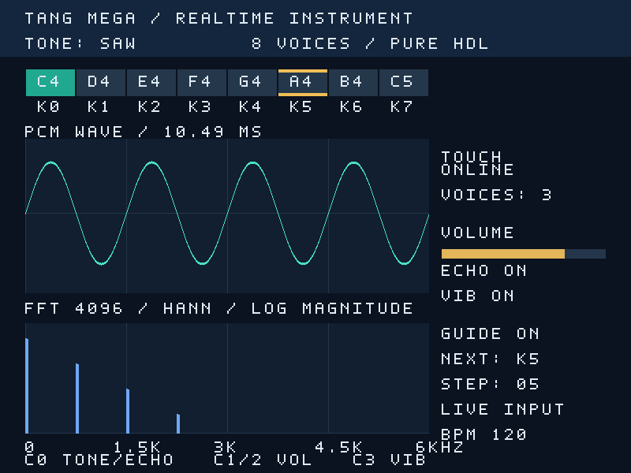
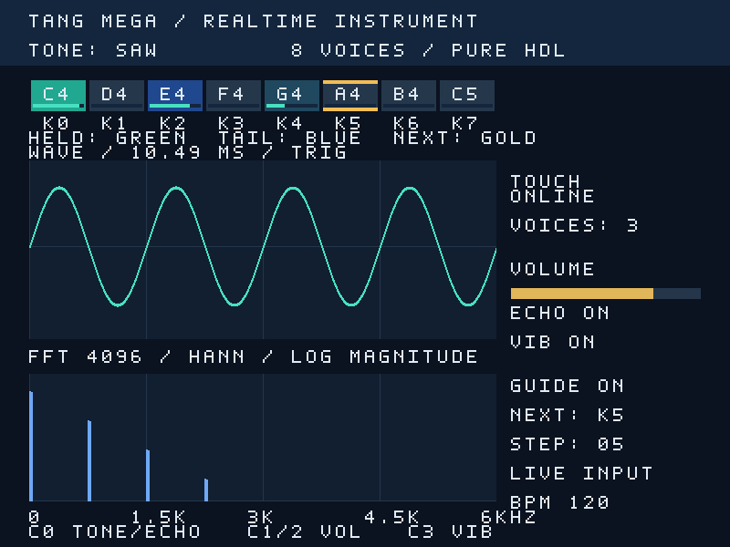

# FPGA 多功能乐器引擎：第一轮针对性改进报告

日期：2026-10-09。基线提交：`97c4f0a8d49f3b0091a7c928ba9f830fbacb5761`。工程：桌面 `fpga_competition/fpga_realtime_multitimbral_synth`。本轮通过独立分支提交供协作者审阅，尚未下载至开发板。

## 本轮结果

本轮重点改善波形响应和键盘反馈，保留原有八声部、四音色、ADSR、音量、颤音、延迟、I2S 和 4096 点 FFT 的音频功能。同时预留原始 PCM、公开 FFT 复数数据、时间标识和识别结果接口，供后续听音算法接入。

- 波形与 FFT 已分离。独立波形采集的真实时钟仿真中，连续发布间隔为 16.5792 ms，约 60.32 Hz；这是仿真测量，不是实物屏幕测量。
- 键盘现可区分按下、释音和空闲，显示每声部实际 ADSR 包络，并保留练习目标高亮。
- 听音接口明确区分本机输出与外部输入；当前没有麦克风接收器，也没有宣称已经实现音高/和弦识别。
- 验证结论见下表；高云构建最初被许可证服务器阻断；改用本地许可后确认主机ID不匹配，尚无本轮布局布线、资源利用率和新下载文件。

## 波形改进

### 基线问题

原 `audio_spectrum` 同时负责 512 点波形和 4096 点 FFT。采集 4096 个样本约需 83.89 ms，FFT 计算和显示确认又增加等待，导致波形内容约每秒更新十次。显示时钟约60 Hz并不能使数据本身更流畅。

### 实现

新增 `instrument/src/waveform_capture.v`，独立获取实际输出 PCM。采集长度保持512点，时间跨度约10.49 ms。优先在负值到非负值的过零位置触发；若128个样本内没有触发，则强制开始采集，因此静音、直流和低幅输入也能刷新。

波形做固定比例 `sample >>> 6` 映射，限制到 ±90 像素，避免上下端超出显示区。此限制只作用于显示，不改变 DAC 音频。绘制相邻样本间的垂直连接段，让斜率大的位置也保持连续；它是示波显示的连线方式，不代表生成了新的音频样本。

`visual_buffer` 增加 `ADDRESS_BITS` 参数。顶层现在采用两个各512点、各双缓冲的存储实例：波形1024字节，频谱1024字节，总计仍为2048字节，与基线显示数据存储容量相同。不同宽度可能影响最终 BSRAM 的物理映射，不能据此宣称实际资源数一定相同。

FFT 整机实例设置 `ENABLE_SCOPE=0`，仅发布频谱；默认值保留为1，以兼容原模块的复用和测试方式。FFT 的数学计算、窗函数、4096点长度和频谱显示范围保持原样。

波形完成一帧后等待像素端在垂直消隐期间接收，再换写入银行。等待只暂停显示快照采集，音频采样和 DAC 输出继续运行。最大触发等待约2.62 ms，加512点采集约10.49 ms，满足当前每帧16.5792 ms的更新预算。

### 验证与边界

`tb_waveform` 检查过零触发、静音超时、完整512点顺序、正负饱和、等待确认期间不写入、复位重启。`tb_scope_link` 使用实际50 MHz系统时钟、40 MHz像素时钟和每1024系统周期一个样本，检查完整银行读取与持续发布间隔。

60.32 Hz 是固定配置及测试输入下的持续发布结果；本轮没有实现滚动历史、自动增益、峰值包络降采样或多通道波形。过零触发主要改善周期单音稳定性，多音和弦的形状仍会自然变化。

## 键盘反馈改进

- 修正分隔线：键号、边框与高亮统一用 `px-32` 的相对坐标，消除原先半个键宽的错位。
- 按下使用绿色；松开但声部仍活动时使用蓝色，亮度随包络减弱；声部结束后回到空闲颜色。
- 每键增加包络条，读取独立声部 ADSR 高8位，而非用视觉计时器模拟余音。
- 练习目标保留金色边缘，不盖住按键中心和包络条；新增颜色说明。
- 状态和8个包络组成104位数据，经同一个 mailbox 跨时钟域传输，在垂直消隐时整体锁存，降低状态撕裂风险。

新增包络输出只读取已有状态，没有改变声部的相位更新、波表、包络算法和音量计算。按下反馈依旧在帧边界更新，额外显示等待为0～约16.58 ms，触摸传感器本身的检测时间另计。

`tb_screen_feedback` 检查按下/释音/空闲颜色、分隔线位置、实际包络条、帧边界更新、练习目标覆盖、正负波形及陡峭连线。界面对比图使用相同确定性波形/频谱与按键状态：K0按下，K2/K4为仍在活动的释音声部；图片来自RTL渲染，不是板卡截图。





## 听音算法接口

新增 `instrument/src/listening_analysis_port.v`；详细协议见 [听音接口说明](listening_interface.md)。

原始音频接口提供有符号PCM16、单周期有效信号、样本编号、精确采样率分子/分母和输入来源。它没有背压，算法不能阻塞演奏音频；耗时算法必须自行缓冲。

FFT 模块公开复数实部/虚部、第0频点标志和采集窗口首样本编号，避免后续算法依赖模块内部变量。现有FFT是间歇快照，只输出前512点；需要连续重叠窗、更高频范围或外部听音时，要另行扩展采集与处理。

结果入口采用96位统一载荷，预留窗口末样本编号、Q8频率、12音级集合、MIDI音符、置信度、标志、来源与乐音判定。通过 valid/ready 接收，保存最近结果，默认一秒没有新结果就失效，即使输入停止也不会一直显示旧结果。

顶层外部输入和结果入口当前明确接零。未使用的数据接口允许被综合器裁剪，当前没有新增硬件引脚、ADC、麦克风或识别结果UI。接入下一阶段算法时，需要替换接零连接、设置来源/采样率，并按需增加异步FIFO和结果到显示域的mailbox。

建议下一阶段先实现单音音高和音准评价，再根据赛题原文决定多音/和弦或旋律节奏跟踪。单音可评估YIN/自相关与FFT谐波评分；YIN原始研究见 [de Cheveigné & Kawahara, 2002](https://pubmed.ncbi.nlm.nih.gov/12002874/)。这里没有为未实现算法承诺准确率、延迟或FPGA资源指标。先使用本机合成数据建立可重复验证，再增加真实外部录音、噪声、八度错误和多音评测。

## 验证记录

工具：XSim 2018.3、Gowin V1.9.12.03 GW5A原语仿真库、Python/Numpy/Pillow。除原有10项外新增5项测试，测试脚本已纳入全部项目。

| 验证 | 结果 | 说明 |
|---|---|---|
| 原有10项仿真 | 通过 | 控制、延迟、合成、触摸、时钟、FFT、视频、跨域、串行视频、数字延迟 |
| 波形采集 | 通过 | 触发、超时、带符号缩放、写入顺序、确认等待、复位 |
| 键盘及连线像素测试 | 通过 | 三种键状态、包络、帧锁存、边框、目标音、连线 |
| 听音接口 | 通过 | 来源、编号、结果握手、无样本时过期、复位 |
| 实际时钟波形整链路 | 通过 | 四帧完整读取；连续间隔16,579,200 ns |
| 完整顶层整链路 | 通过 | 原语模型、PLL/复位、紧凑银行；加速分析采样与消隐使能 |
| Python音频分析 | 通过 | 8个独立谱峰、4音色谐波、释音归零、音量比例 |
| Python FFT参考比较 | 通过 | 3场景复数最大误差0、9.21084、8.51166 PCM单位，阈值16 |
| 同输入屏幕前后渲染 | 通过 | 同一确定性输入的800×600 RTL输出 |
| Gowin综合/布局布线 | 未完成 | `License verification failed  License hostid not match.`；本地许可与构建主机不匹配 |
| 实物听感/屏幕/端到端延迟 | 未测 | 需要下载及板卡测试 |

数字延迟测试测得最大106,830 ns，即约0.10683 ms；只包括触摸状态到首个非零I2S帧，不能当作实际触摸到模拟声音的整机延迟。音频分析捕获峰值9140 PCM16单位，音量四分之一比例0.2495489；这些是既有测试场景结果，不覆盖所有硬件故障或未来算法。

本轮最终验证由14项回归与新增完整顶层专项组成，并重跑相同输入的显示渲染。顶层专项为缩短HDMI全链路仿真时间，加速了分析采样和消隐使能，仅验证整机连接/银行映射；真实时钟刷新率由独立 `tb_scope_link` 验证。顶层检查中首帧FFT完成前已发布54帧波形。源代码级仿真不验证最终布线时序、BSRAM/DSP实际占用或电气连接。

## 改动文件与复现

新增：`waveform_capture.v`、`listening_analysis_port.v`、5个测试平台与2份文档。修改：顶层/核心/声部包络输出、屏幕、参数化显示缓冲、FFT公开接口、工程文件、测试脚本、FFT和视频测试、README。

在工程根目录配置现有工具路径后运行：

```powershell
.\instrument\sim
un.ps1 -VivadoBin '<Vivado bin>' -GowinSimLib '<GW5A prim_sim.v>'
.\instrumentuild.ps1 -GowinShell '<gw_sh.exe>'
```

仿真脚本运行15个平台并执行音频/显示分析。高云构建恢复后，需确认setup/hold违反端点为0，查看本轮资源报告，再下载验证。当前没有可宣称时序通过的新bitstream。

## 上板验收建议

1. 静音、单音、快速重复按键、八键和弦下观察波形刷新，确认不会随FFT一起停顿。
2. 检查八键边界、按下绿色、松开蓝色余音、包络条最终归零、练习目标高亮。
3. 回归音色、音量、延迟、颤音、练习和测试模式，确认声音与基线一致。
4. 检查拔插触摸模块、PLL复位和显示恢复；实测端到端延迟。
5. 听音硬件接入后，验证真实采样率、输入溢出、来源标识、无声与结果失效，再评价识别算法。
