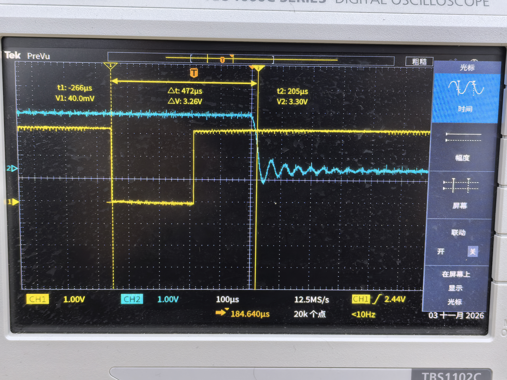
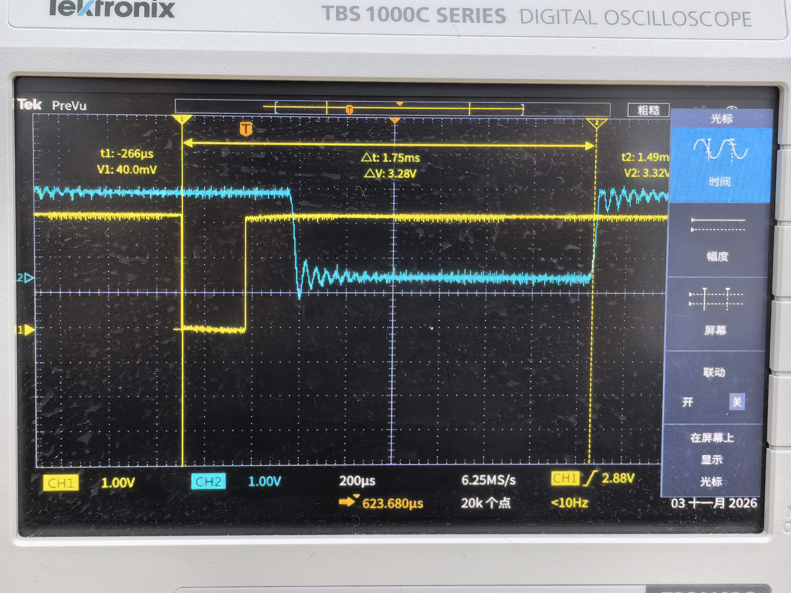

# 响应测量与波形记录

## 计量区间

| 记录 | 起点与终点 | 数值 |
|---|---|---|
| 数字核心 RTL | T0 触摸状态进入核心 → 完整非零 I²S 样本 | 47.93～65.87 μs，8 个触发相位 |
| 现场照片一 | MPR121 IRQ 下降沿 → LOUT 首次明显突变附近的光标 | 472 μs |
| 现场照片二 | MPR121 IRQ 下降沿 → LOUT 较晚一次变化的光标 | 1.75 ms |

三项记录按各自端点报告。IRQ 表示触摸控制器的状态变化；两张现场照片分别保留指定 LOUT 波形事件的游标读数，适用范围为单次电气事件观测。数字核心响应覆盖 FPGA 控制状态入口至 I²S 样本输出，传感器判定与 DAC 模拟链路另行计量。

数字测试的 8 个触发相位依次得到 60.63、58.09、55.55、53.01、50.47、47.93、65.87、63.33 μs，最小值 47.93 μs、最大值 65.87 μs、相位间峰峰差 17.94 μs。测试条件为 T0、节拍器关闭；[原始数值](evidence/latency_expression.csv)与[测试平台](../instrument/sim/tb_latency.sv)一同保留。

表情采样单列：三通道 ADS1115、100 kHz I²C、2 ms 转换等待模型中，每通道更新周期为 **9.97572 ms**，即约 **100.24 Hz**。该值描述模拟控制量刷新频率。

## 双通道记录

仪器：Tektronix TBS1102C。CH1 接 MPR121 IRQ，CH2 接 PCM5102 模块 L/LOUT，两个地夹均接对应公共地。保留原始图像，未改动波形与读数。

照片一：100 μs/div、12.5 MS/s、两通道均为 1 V/div。黄色波形下降沿为 IRQ 有效方向，随后回高；蓝色波形在右侧光标附近出现明显变化。游标值 Δt = 472 μs。

照片二：200 μs/div、6.25 MS/s、两通道均为 1 V/div。Δt = 1.75 ms；右侧光标选择后续一次输出变化，其前方可见先前的下降和衰减振荡。

## 可复现的测量步骤

1. 使用固定音色和音高，关闭延音、效果与节拍器，先确认松手静音、触键正常发声。记录位流哈希、音量及压力状态。
2. 示波器高阻输入、DC 耦合，探头倍率与通道设置一致。CH1 以 IRQ 下降沿触发，阈值取高低电平中间。两个地夹只接 GND，探头并联测量。
3. 同一采集保留触发前静音区和触发后完整音频。终点按预先设定的幅度阈值和持续时间判定，避开孤立毛刺；使用同一判据处理所有记录。
4. 每次松开并等待释放后重新触键，逐次导出波形与数值。IRQ→LOUT 作为中断参考响应；若测手指接触→LOUT，还需独立的接触时刻参考。
5. 统一条件下积累逐次数据后再计算 min、mean、max、p95；jitter 明确采用峰峰差或标准差。

IRQ 对应模块 P3-2 或 P2-2，当前 FPGA 通过 I²C 轮询触摸，IRQ 不接入 FPGA 逻辑。不要将 U1-12/J13-12 的 GND 当作 IRQ。具体针号见[接线清单](wiring_current.md)。
